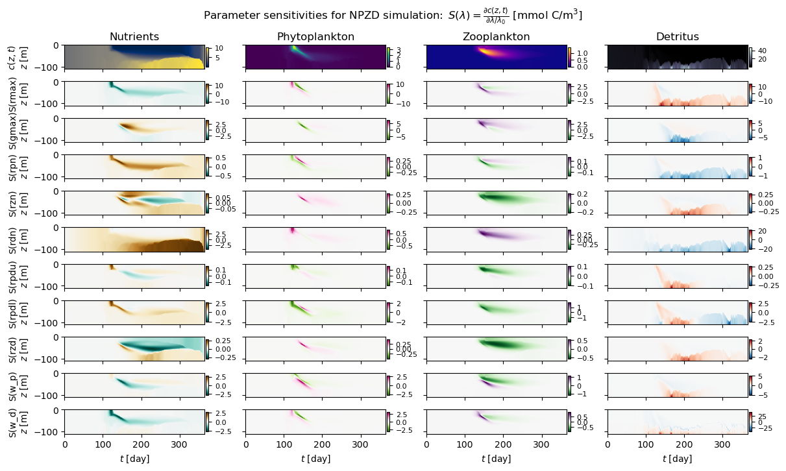

.. image:: https://img.shields.io/badge/code%20style-black-000000.svg
    :target: https://github.com/psf/black

.. image:: https://github.com/m-dml/MARINADE/actions/workflows/ci.yml/badge.svg?branch=main
    :target: https://github.com/m-dml/MARINADE/actions/workflows/ci.yml

.. image:: https://github.com/m-dml/MARINADE/actions/workflows/documentation.yml/badge.svg?branch=main
    :target: https://github.com/m-dml/MARINADE/actions/workflows/documentation.yml

====================================
Documentation of MARINADE
====================================

MARINADE is a set of differentiable re-implementations of diffusion and advection operators from `GOTM <https://gotm.net/portfolio/>`_
and marine biogeochemical models inspired by `FABM <https://github.com/fabm-model/fabm/wiki>`_.

Full documentation at https://m-dml.org/MARINADE/

Demonstrations of MARINADE and its support for automatic differentiation can be found in the `notebooks folder <https://github.com/m-dml/MARINADE/tree/main/notebooks>`_.
For instance, the following illustration from the `sensitivity analysis notebook <https://github.com/m-dml/MARINADE/tree/main/notebooks/sensitivity_analysis_fda_npzd.ipynb>`_ visualizes parameter sensitivities computed with MARINADE-NPZD:

MARINADE includes:

* An implicit or semi-implicit vertical diffusion operator using a tridiagonal solver (re-implementation from GOTM with added tridiagonal solver options)
* An explicit vertical advection operator (re-implementation from GOTM)
* Re-implementations of biogeochemical (BGC) models:

    - The prototypical NPZD model introduced by `Burchard et al. (2005) <https://doi.org/10.1007/s10236-005-0001-x>`_ (`GitHub <https://github.com/fabm-model/fabm/blob/master/src/models/gotm/npzd.F90>`_)
    - The FABM version of ERGOM ported by Gennadi Lessin (`GitHub <https://github.com/fabm-model/fabm/blob/master/src/models/gotm/ergom.F90>`_)
    - ECOSMO II by `Daewel and Schrum (2013) <https://doi.org/10.1016/j.jmarsys.2013.03.008>`_ (without fish)
    - The GOTM light model (`GitHub <https://github.com/fabm-model/fabm/blob/master/src/models/gotm/light.F90>`_)
    - As well as an extendable base class for BGC models

* A coupling operator for advection, diffusion and BGC operators

Our example notebooks include (but are not limited to):

* Usage of vertical advection, diffusion and BGC operators (`test_gotm_operators.ipynb <https://github.com/m-dml/MARINADE/tree/main/notebooks/test_gotm_operators.ipynb>`_)
* Sensitivity analysis and finite difference approximation for NPZD model (`sensitivity_analysis_fda_npzd.ipynb <https://github.com/m-dml/MARINADE/tree/main/notebooks/sensitivity_analysis_fda_npzd.ipynb>`_)
* Joint state-parameter estimation in observing system simulation experiment with 4D-Var (`4DVar_adda_npzd.ipynb <https://github.com/m-dml/MARINADE/tree/main/notebooks/4DVar_adda_npzd.ipynb>`_)

--------------------------------------------

Installation
------------
To install you have to clone the repository and install it with pip:

.. code-block:: bash

   git clone https://github.com/m-dml/MARINADE
   cd MARINADE
   pip install -e .

--------------------------------------------

Technical Info
--------------
We use a custom backward method for the tridiagonal solver used by our implicit diffusion operator (see `documentation <https://m-dml.org/MARINADE/backward.html>`_).
